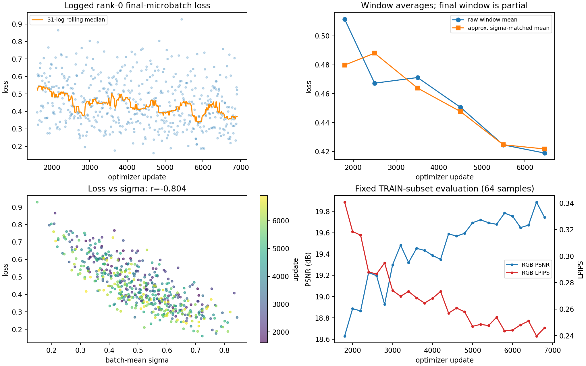

# RGB projection 实验的 loss 分析

分析对象：`projection_rgb_3npu_resume_3card_20261110_110818`。本次日志快照覆盖 step 1610～6910，531 个记录点，每 10 次更新记录一次。

## 最关键的几个点

1. **训练稳定，整体仍在改善，但近期收益放缓**。前 100 个记录点平均 loss 为 0.4945，后 100 个为 0.4127，降低约 16.5%。
2. **单点波动与噪声强度高度相关**：记录的 loss 与 batch-mean sigma 的相关系数为 -0.804，不能只看某个点突然升高或降低。
3. **日志不是有效 batch 的全局均值**：代码记录主进程最后一个 micro-batch 的 loss，未聚合三卡、三个梯度累积 micro-batch 的全部样本。
4. **周期评估也有提升，但属于训练内固定子集**，不能作为未见场景泛化的独立证据。

## 分段趋势

| 更新区间 | 记录点数 | 平均 loss | 中位数 |
|---|---:|---:|---:|
| 1610～1990 | 39 | 0.5115 | 0.5412 |
| 2000～2990 | 100 | 0.4672 | 0.4509 |
| 3000～3990 | 100 | 0.4712 | 0.4674 |
| 4000～4990 | 100 | 0.4506 | 0.4209 |
| 5000～5990 | 100 | 0.4246 | 0.3994 |
| 6000～6910 | 92 | 0.4190 | 0.3910 |

近期两个区间的均值仅下降约 1.3%，明显慢于前期。按日志中的平均 sigma 粗略分组、统一分组权重后，近期均值约从 0.4247 降至 0.4218，仍呈改善放缓。该处理只是描述性检查，不能替代逐样本噪声条件评估。

## 为什么会有明显锯齿

当前有效 batch 为三卡 × 每卡 micro batch 2 × 梯度累积 3，即 18 个样本；日志显示的是主进程最后两个样本的 loss。不同场景、相机跨度、目标视角与噪声强度都会改变难度。

在这份记录中，sigma < 0.3 时平均 loss 约 0.693；sigma 为 0.6～0.75 时约 0.326。它们是不同条件下的误差，单点不可直接当成模型优劣排序。

loss 衡量的是目标 latent 的 masked velocity MSE。日志 `w_mean=1`，RGB 辅助 loss 关闭；主学习率维持 `3e-5`，没有在后段发生学习率衰减。

## 固定评估子集的结果

| 评估步数 | RGB PSNR ↑ | LPIPS ↓ | depth aligned AbsRel ↓ |
|---|---:|---:|---:|
| 1800 | 18.6296 | 0.3407 | 0.1574 |
| 6000 | 19.7553 | 0.2442 | 0.1198 |
| 6600 | 19.8870 | 0.2397 | 0.1179 |
| 6800 | 19.7438 | 0.2459 | 0.1273 |

训练目标与这些评估结果共同支持“模型仍在有效学习、后期进入缓慢改善与波动阶段”。step 6800 相比 6600 的回退不能单独证明训练已经退化。

重要限制：训练代码用 `copy.copy(train_dataset)` 构造固定 64 个场景的评估子集；这里没有独立的场景级 train／val 隔离。独立测试证据应参考另行完成的 10 场景、30 组对比，而不是把上表称为独立验证集结果。

## 产物

服务器目录：`rgbd_video_gen_gae/reports/projection_rgb_loss_analysis_20261112/`，包含 `summary.json`、`loss.csv` 和 `loss_analysis.png`。

